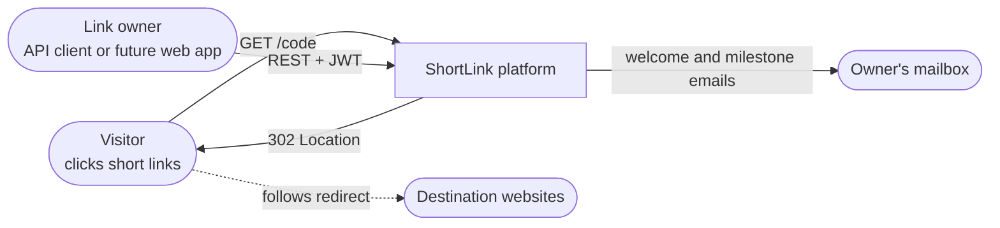
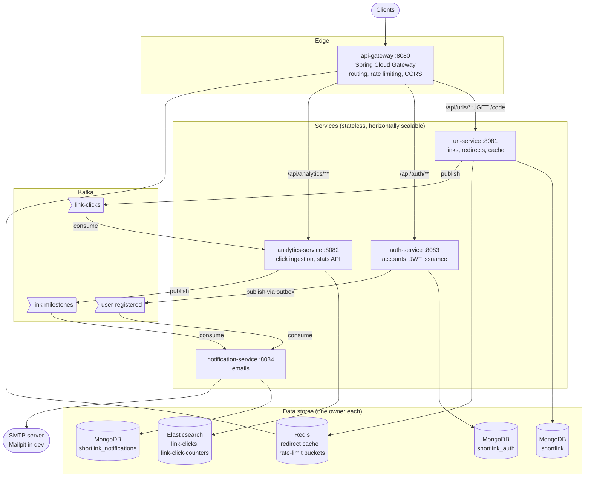
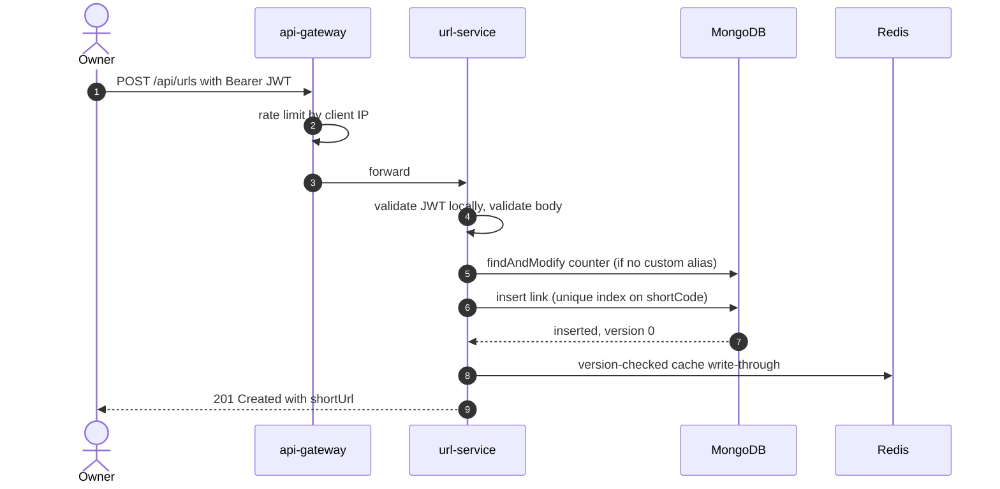
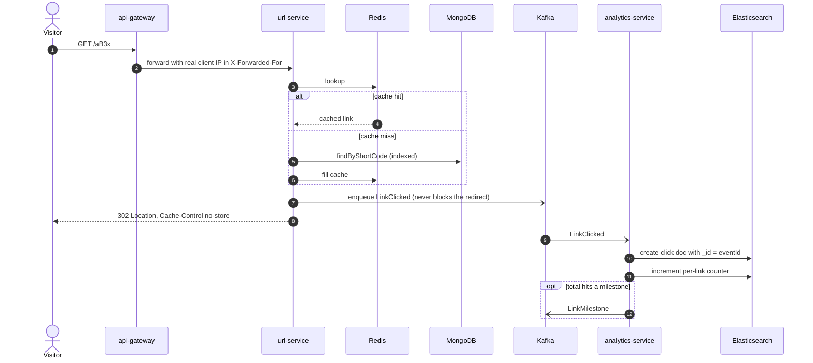
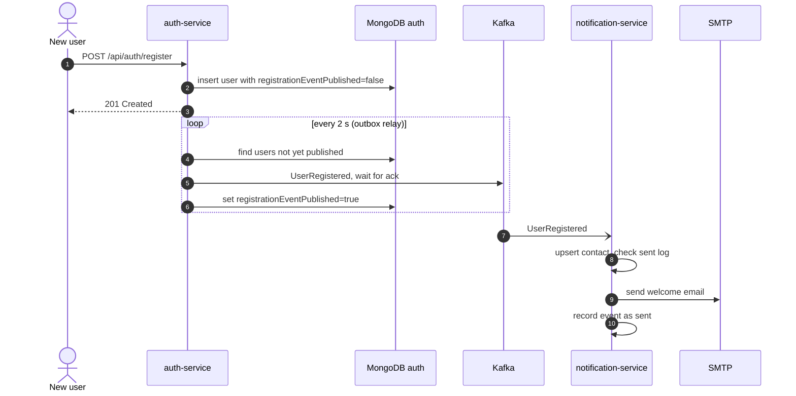
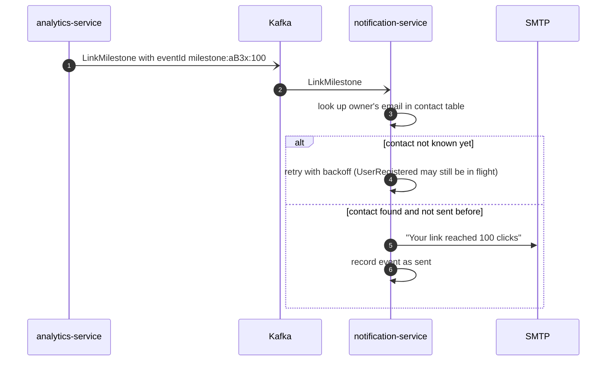
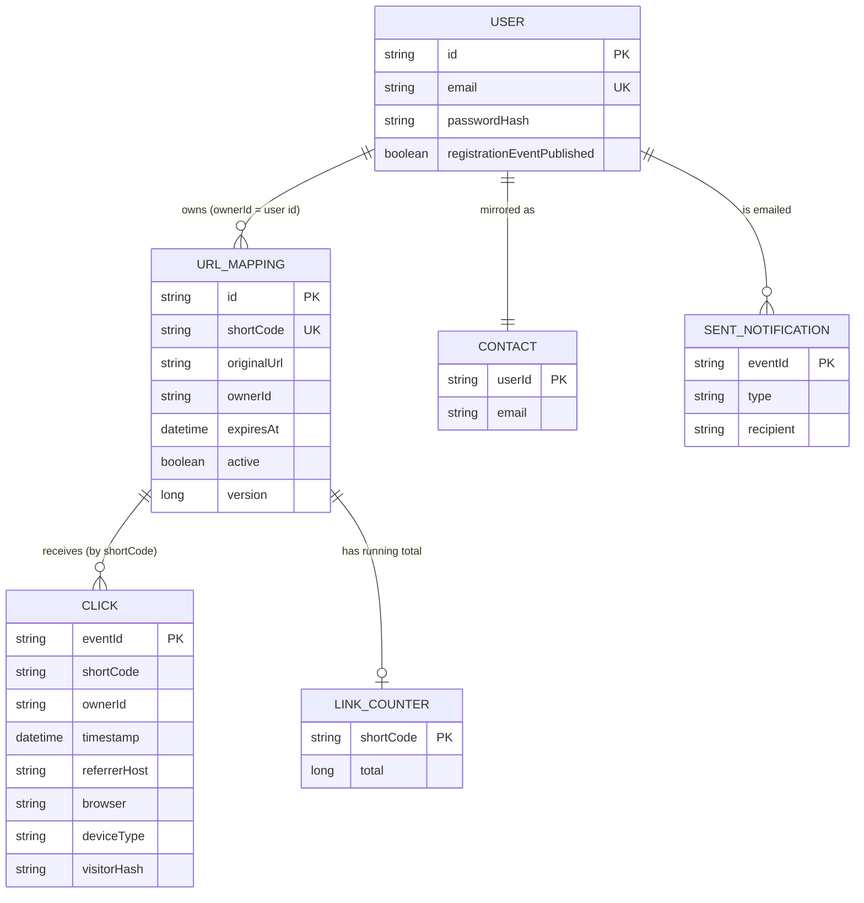
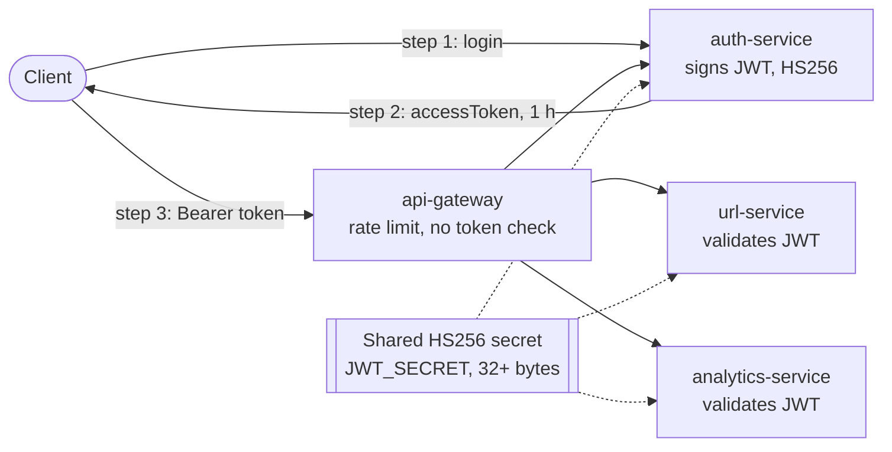
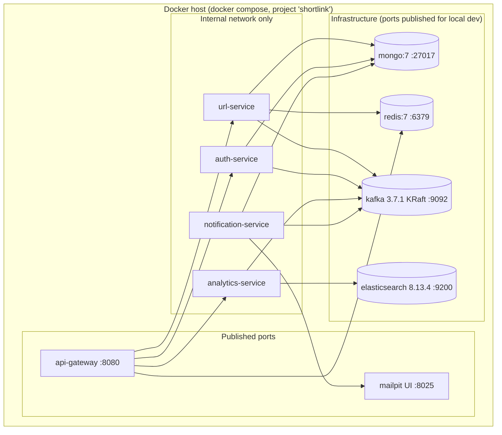

# ShortLink: High-Level Design (HLD)

| | |
|---|---|
| **System** | ShortLink, a URL shortener with real-time click analytics |
| **Version** | 0.1.0 |
| **Companion doc** | [LLD.md](LLD.md) covers class design, algorithms, data schemas and detailed flows |
| **Diagrams** | Mermaid (rendered natively on GitHub and in most IDE Markdown previews) |

---

## 1. Purpose and scope

ShortLink turns long URLs into short codes (`https://sho.rt/aB3x`), redirects
visitors to the original URL, and shows link owners who clicked, when, and
from where. This document describes the system's architecture: its
services, data stores, communication paths, and the reasoning behind the
major technical choices.

**In scope:** link management, redirects, accounts and authentication, click
analytics, email notifications, edge routing and rate limiting.
**Out of scope (today):** a web frontend, custom domains, link previews,
billing, and admin tooling.

---

## 2. Requirements

### 2.1 Functional

| ID | Requirement |
|---|---|
| F1 | A registered user can shorten a URL, either with a generated code or a custom alias (3–32 characters). |
| F2 | Anyone can follow a short link and is redirected (HTTP 302) to the original URL. |
| F3 | Links can have an optional expiry; expired links return 410 Gone. |
| F4 | Owners can list, view, edit (destination and expiry) and deactivate their links. Nobody else can. |
| F5 | Owners can see per-link analytics: total clicks, unique visitors, clicks per day, top referrers, browsers, operating systems and device types. |
| F6 | Users get a welcome email on sign-up and an email when a link reaches 1, 10, 100, 1,000 … clicks. |

### 2.2 Non-functional

| ID | Quality | Target and design response |
|---|---|---|
| N1 | **Redirect latency** | Low single-digit ms server-side on a cache hit; reads dominate writes roughly 100:1. Served by a Redis cache in front of an indexed MongoDB lookup. |
| N2 | **Redirect availability** | Redirects must survive the loss of any non-essential dependency (Redis, Kafka, Elasticsearch, SMTP, auth-service). Only MongoDB is on the critical path. |
| N3 | **Correctness of codes** | A short code maps to exactly one link, always. Enforced by a unique database index, not application checks. |
| N4 | **Analytics freshness** | Eventually consistent, within seconds. Each click counted exactly once despite at-least-once delivery. |
| N5 | **Security** | Stateless JWT auth; owner-scoped management and analytics; brute-force and abuse limited at the edge. |
| N6 | **Privacy** | Raw visitor IPs never leave the redirect service; analytics store only derived, non-identifying fields. |
| N7 | **Scalability** | Every service stateless and horizontally scalable; data stores partitioned by short code. |
| N8 | **Operability** | Liveness and readiness probes per service, metrics, and dead-letter topics for failed events. |

---

## 3. Capacity estimates (illustrative)

These are sizing assumptions for discussion, not measured production figures.
Assume **100 M redirects/day** and **1 M new links/day**.

| Quantity | Estimate |
|---|---|
| Redirect rate | 100 M / 86,400 s ≈ **1,200 req/s** average, ~6,000 req/s at a 5× peak |
| Link creation rate | ≈ 12 req/s average, ~60 req/s peak |
| Links after 5 years | 1 M × 365 × 5 ≈ **1.8 B** documents ≈ 0.7 TB at ~400 B each (plus indexes) |
| Short-code length | 1.8 B < 62⁶ (56.8 B), so generated codes stay **≤ 6 characters** for 5 years; 7 characters covers 3.5 T |
| Redis hot set | ~10 M hot links × ~250 B ≈ **2.5 GB** |
| Click events | 100 M/day × ~350 B ≈ 35 GB/day in Kafka (≈ 245 GB at 7-day retention); similar or more in Elasticsearch |

What the estimates imply (and section 12 lists as future work): Elasticsearch
needs time-based indices with lifecycle management, and ingestion should use
the bulk API at this volume.

---

## 4. Architecture overview

### 4.1 System context

### 4.2 Container view

### 4.3 Architectural style

- **Microservices with database-per-service.** Each service owns its data
  and no service reads another's store. The three MongoDB databases share
  one server in development only.
- **Synchronous HTTP at the edge, asynchronous events behind it.** Clients
  talk to the gateway over REST. Services never call each other
  synchronously; anything that crosses a service boundary after the
  request (click analytics, emails) travels over Kafka.
- **No shared code between services.** Each service keeps its own copy of
  the event records it produces or consumes, and readers ignore unknown
  fields, so services build and deploy independently.

---

## 5. Service responsibilities

| Service | Responsibility | Owns | Talks to |
|---|---|---|---|
| **api-gateway** | Single public entry point: path routing, per-IP token-bucket rate limits, CORS, rejecting non-code paths, sanitising `X-Forwarded-For` | Rate-limit buckets (Redis) | All HTTP services |
| **url-service** | Short-code generation, link CRUD, ownership checks, the redirect, Redis cache-aside, publishing click events | `url_mappings`, `counters` (Mongo); `shortlink:url:v2:*` (Redis) | Mongo, Redis, Kafka (produce) |
| **auth-service** | Registration, login, JWT issuance, `/me`; publishing `UserRegistered` through an outbox | `users` (Mongo) | Mongo, Kafka (produce) |
| **analytics-service** | Consuming clicks, enrichment (referrer host, browser, OS, device), idempotent indexing, milestone detection, stats API | `link-clicks`, `link-click-counters` (Elasticsearch) | Elasticsearch, Kafka (consume and produce) |
| **notification-service** | Maintaining a user-id-to-email contact table, sending welcome and milestone emails exactly once per event | `contacts`, `sent_notifications` (Mongo) | Mongo, Kafka (consume), SMTP |

---

## 6. Communication

### 6.1 Synchronous (HTTP through the gateway)

| Route | Service | Auth | Rate limit per IP |
|---|---|---|---|
| `POST /api/auth/register`, `POST /api/auth/login` | auth | public | 2/s, burst 10 |
| `GET /api/auth/me` | auth | JWT | 2/s, burst 10 |
| `/api/urls`, `/api/urls/{code}` | url | JWT, owner-scoped | 10/s, burst 30 |
| `/api/analytics/links[/{code}]` | analytics | JWT, owner-scoped | 5/s, burst 20 |
| `GET /{code}` | url | public | 50/s, burst 100 |

All errors are RFC 9457 `application/problem+json`.

### 6.2 Asynchronous (Kafka)

| Topic | Key | Producer | Consumer group | Purpose |
|---|---|---|---|---|
| `link-clicks` | shortCode | url-service | analytics-service | One event per successful redirect |
| `user-registered` | userId | auth-service | notification-service | Builds the contact table and triggers the welcome email |
| `link-milestones` | shortCode | analytics-service | notification-service | Click total reached 1, 10, 100, … |
| `<topic>.DLT` | same as source | consumer's error handler | operators (replay) | Events that failed permanently or after retries |

Topics have 3 partitions (replication factor 1 in dev). Keying by short code
keeps all clicks for a link on one partition, in order.

---

## 7. Key flows (high level)

Detailed versions, including every branch and failure path, are in the LLD.

### 7.1 Create a short link

### 7.2 Redirect and click analytics

### 7.3 Sign-up to welcome email

### 7.4 Click milestone to email

---

## 8. Data architecture

| Store | Data | Access pattern | Why this store |
|---|---|---|---|
| **MongoDB** (`shortlink`) | Link mappings, code counter | Point lookups by `shortCode` (unique index); owner listing by `ownerId, createdAt` | Flexible documents, atomic `findAndModify` for the counter, unique indexes, straightforward sharding by `shortCode` |
| **MongoDB** (`shortlink_auth`) | Users | Lookup by normalized email (unique) and id | Same operational footprint as above; single-document atomicity gives the outbox |
| **MongoDB** (`shortlink_notifications`) | Contacts, sent-email log | Lookup by user id and event id | Simple key-value style access with persistence |
| **Redis** | Redirect cache entries, rate-limit buckets | O(1) get/set, Lua scripts | Sub-millisecond reads; Lua gives atomic compare-and-set |
| **Elasticsearch** | One document per click, one counter per link | Filtered aggregations (terms, cardinality, date histogram) | Built for exactly this kind of slice-and-count analytics |
| **Kafka** | Event streams | Append, partitioned by key, replayable | Decouples producers from consumers; buffers through downstream outages |

### 8.1 Logical data model

Relationships between services are logical only (shared ids), never foreign keys.

---

## 9. Cross-cutting concerns

### 9.1 Security

- **Authentication.** auth-service issues HS256 JWTs (1 h, `sub` = user id).
  Every service that serves user data validates signature, issuer and expiry
  itself. Nothing trusts a header set upstream, and login being down doesn't
  affect requests that already carry a token.
- **Authorization.** Ownership is checked in the services, not the gateway.
  A non-owner gets the same 404 as for a missing link, so the API never
  confirms that a code belongs to someone else. Analytics queries always
  filter on the caller's id.
- **Abuse control.** Per-IP token buckets at the gateway, strictest on login
  and registration. Login takes the same time for unknown emails as for
  wrong passwords, so timing doesn't reveal which emails have accounts.
- **Input safety.** URLs must parse as absolute http(s) URLs with a host,
  contain no whitespace or control characters (no header injection), and
  must not point back at the shortener (no redirect loops). Aliases can't
  shadow system paths (`api`, `actuator`, `error`, …).
- **Secrets.** No secrets in the repository; services refuse to start
  without a JWT secret of at least 32 bytes.
- **Privacy.** url-service replaces the visitor IP with
  `HMAC(key, ip | user agent)` before anything leaves it; Elasticsearch
  stores only derived fields such as browser family and referrer host.

### 9.2 Resilience and failure modes

| Dependency down | Redirects | Link management | Analytics / email | Mechanism |
|---|---|---|---|---|
| Redis | ✅ ~10 ms, from Mongo | ✅ | ✅ | 250 ms timeouts, fail-fast Lettuce, circuit breaker; gateway limiter fails open |
| Kafka | ✅ | ✅ | ⏳ delayed; clicks dropped if the local queue fills | Bounded async publisher; auth outbox holds registrations |
| Elasticsearch | ✅ | ✅ | ⏳ stats API 503; clicks wait in Kafka | Consumer retries with backoff, then DLT |
| SMTP | ✅ | ✅ | ⏳ emails retried, then DLT | Consumer retries with backoff |
| auth-service | ✅ | ✅ with an existing token | ✅ | JWTs validated locally |
| MongoDB | ❌ cache hits only | ❌ | ⏳ | Mongo is the system of record |

Readiness probes exclude dependencies a service can live without (Redis is
never in url-service's readiness check), so an orchestrator doesn't pull
healthy instances out of rotation over a cache outage.

### 9.3 Consistency model

| Data | Model |
|---|---|
| Link records | Strongly consistent in MongoDB; concurrent edits rejected with 409 (optimistic locking). |
| Redirect cache | Every write is version-checked, so the cache can't move backwards; TTLs (1 h positive, 60 s negative) bound staleness if a write-through is lost. |
| Click analytics | Eventually consistent (seconds); exactly-once counting on at-least-once delivery, using the event id as the document id. |
| Milestones and emails | At-least-once with idempotency keys; a duplicate email is possible only after a crash between sending and recording it. |

### 9.4 Observability

- `/actuator/health/liveness` and `/actuator/health/readiness` on every
  service; `/actuator/health` aggregates everything for visibility.
- Micrometer metrics at `/actuator/metrics`, including
  `shortlink.clicks.published`, `shortlink.clicks.failed` and
  `shortlink.clicks.dropped`.
- Dead-letter topics capture failed events together with exception headers.
- Logging is rate-limited on hot failure paths, so an outage produces a
  handful of lines instead of one per request.

---

## 10. Deployment view

- **One image recipe.** A single multi-stage Dockerfile builds any service
  (`--build-arg SERVICE=…`) and runs it as a non-root user, with the heap
  sized from the container's memory limit.
- **Only the gateway is exposed**, which is what makes trusting its
  `X-Forwarded-For` header safe.
- **Startup ordering.** Compose health checks gate services on their
  infrastructure. Services also tolerate a dependency arriving late: topics
  are declared by producers and consumers, and the Elasticsearch schema is
  installed lazily.
- **Production path.** Kubernetes Deployments using the existing liveness
  and readiness endpoints; managed or replicated MongoDB, Redis, Kafka and
  Elasticsearch; and secrets from a secret store.

---

## 11. Key design decisions

| # | Decision | Alternatives considered | Rationale |
|---|---|---|---|
| D1 | Base62 of an atomic counter for generated codes | Hash of URL (MD5/SHA, truncated); random codes | Collision-free by construction and short. The cost is that codes are sequential, so creation order leaks. |
| D2 | Uniqueness enforced by a unique index, with insert-and-catch | Check `exists()` then insert | Check-then-insert races; the index is atomic. Also covers custom aliases that land on future generated codes. |
| D3 | Cache-aside with version-checked writes | Plain evict on write; write-through only | Plain eviction lets a slow reader write back stale data, so a deactivated link keeps redirecting. Comparing versions makes the cache move forwards only. |
| D4 | Redirect publishes clicks fire-and-forget through a bounded queue | Synchronous send; transactional outbox | The redirect must never wait on Kafka. An outbox would mean a database write per redirect; losing analytics under extreme overload is acceptable. |
| D5 | Outbox flag on the user document | Synchronous publish; separate outbox collection | Registration events must not be lost, and a flag on the same document is atomic without a replica set. |
| D6 | Elasticsearch `_id` = eventId for dedupe | Separate dedupe store; exactly-once Kafka transactions | Idempotent by construction, with no extra infrastructure. |
| D7 | Event-carried state (contact table) in notification-service | Synchronous call to auth-service for the email | No runtime coupling to auth-service's availability. |
| D8 | HS256 JWT validated by each service | Validate at the gateway only; RS256 + JWKS | No implicit trust of the gateway. HS256 is simpler for one team; RS256 is the upgrade path. |
| D9 | JSON strings on Kafka, tolerant readers | Avro/Protobuf with a schema registry; Spring type headers | Simple and language-neutral, with no class-name coupling. A schema registry is worth adding as the number of event types grows. |
| D10 | Gateway rate limits keyed on the TCP peer address | `X-Forwarded-For`; JWT subject | Both alternatives can be forged by the client. |

---

## 12. Risks, limitations and roadmap

| Area | Limitation today | Next step |
|---|---|---|
| Auth | Shared HMAC secret; no refresh tokens or revocation | RS256 + JWKS; refresh tokens; token deny-list |
| Click delivery | Best-effort (bounded in-memory queue) | Accept as a trade-off, or add a local disk-backed buffer |
| Analytics scale | One index, one Elasticsearch request per event; one partition handles each viral link sequentially | Daily indices with lifecycle management; bulk indexing via batch listeners; pre-aggregated rollups |
| Code privacy | Sequential codes reveal volume and allow walking the code space | Keyed permutation (Feistel) of the counter |
| Infrastructure | Single-node Kafka (RF 1), Elasticsearch without TLS/auth | Replicated clusters, TLS, authentication |
| Testing | No integration tests against real infrastructure in the Maven build | Testcontainers suites in CI alongside `scripts/smoke-test.sh` |
| Platform | Spring Boot 3.3.4 is past OSS support | Upgrade to the current Spring Boot 3.x line |
| Product | No frontend, custom domains or QR codes | Separate web app behind the gateway's existing CORS configuration |
