# ShortLink: Low-Level Design (LLD)

| | |
|---|---|
| **Version** | 0.1.0 |
| **Companion doc** | [HLD.md](HLD.md) covers architecture, requirements and trade-offs |
| **Scope** | Per-service class design, data schemas, API contracts, algorithms, flow and sequence diagrams, Kafka and configuration specs |

Contents

1. [Codebase layout](#1-codebase-layout)
2. [Shared conventions](#2-shared-conventions)
3. [url-service](#3-url-service)
4. [auth-service](#4-auth-service)
5. [analytics-service](#5-analytics-service)
6. [notification-service](#6-notification-service)
7. [api-gateway](#7-api-gateway)
8. [Kafka specification](#8-kafka-specification)
9. [Configuration reference](#9-configuration-reference)
10. [Testing strategy](#10-testing-strategy)

---

## 1. Codebase layout

The backend is a Maven multi-module build in `backend/`: one parent POM
pins Java 21, Spring Boot 3.3.4 and Spring Cloud 2023.0.3. There are no
Maven dependencies between modules. The web app in `frontend/` is a
separate npm project (see its README).

```
ShortLink/
├── docker-compose.yml            infra + 5 services (build context: backend/)
├── scripts/smoke-test.sh         end-to-end checks through the gateway
├── frontend/                     React + TypeScript web app (Vite)
└── backend/
    ├── pom.xml                   parent: versions, plugin config, module list
    ├── Dockerfile                one multi-stage image recipe, ARG SERVICE
    ├── url-service/        com.shortlink.urlservice
    │   ├── config/         SecurityConfig, RedisConfig, KafkaConfig
    │   ├── controller/     UrlController
    │   ├── dto/            CreateUrlRequest, UpdateUrlRequest, UrlResponse, PageResponse
    │   ├── event/          LinkClickedEvent, ClickEventPublisher, KafkaClickEventPublisher, VisitorHasher
    │   ├── exception/      GlobalExceptionHandler + domain exceptions
    │   ├── model/          UrlMapping, Counter
    │   ├── repository/     UrlMappingRepository, CounterRepository
    │   ├── service/        UrlService, UrlCacheService, CachedUrlMapping, SimpleCircuitBreaker, Base62Encoder
    │   └── validation/     @HttpUrl, HttpUrlValidator
    ├── auth-service/       com.shortlink.authservice
    │   ├── config/         SecurityConfig, JwtProperties, KafkaConfig
    │   ├── controller/     AuthController
    │   ├── event/          UserRegisteredEvent, UserOutboxRelay
    │   └── model/ repository/ service/ (AuthService, TokenService) dto/ exception/
    ├── analytics-service/  com.shortlink.analyticsservice
    │   ├── config/         SecurityConfig, KafkaConfig, ElasticsearchConfig
    │   ├── event/          ClickEventListener, MilestonePublisher, event records
    │   ├── ingest/         ClickIngestionService, ClickEnricher
    │   ├── repository/     ClickRepository (writes + schema)
    │   ├── service/        AnalyticsService (queries)
    │   └── controller/ dto/ model/ exception/
    ├── notification-service/ com.shortlink.notificationservice
    │   ├── config/         KafkaConfig
    │   ├── event/          NotificationListeners, event records
    │   ├── service/        NotificationService, EmailSender
    │   └── model/ repository/
    └── api-gateway/        com.shortlink.gateway
        ├── config/         RateLimitConfig (KeyResolver)
        └── resources/      application.yml (routes, filters, limits)
```

---

## 2. Shared conventions

### 2.1 Request authentication (url, analytics, auth services)

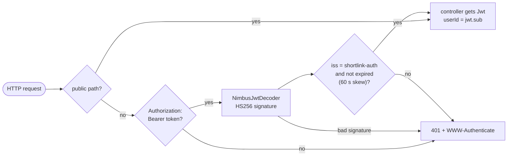

- Stateless (`SessionCreationPolicy.STATELESS`); CSRF disabled because there
  are no cookies.
- Public paths: `/actuator/health/**`, `/actuator/info`, `/error`, plus
  `GET /*` in url-service (redirects) and `POST /api/auth/register|login`
  in auth-service.
- `JwtDecoder` is built from `app.jwt.secret`; startup fails if the secret
  is shorter than 32 bytes (HS256 needs a 256-bit key).

### 2.2 Error model

Every service extends `ResponseEntityExceptionHandler` and returns RFC 9457
`application/problem+json`, including Spring's own exceptions (malformed
JSON, unknown path, wrong method).

```json
{
  "type": "about:blank",
  "title": "Bad Request",
  "status": 400,
  "detail": "Request validation failed",
  "instance": "/api/urls",
  "errors": [
    { "field": "originalUrl", "message": "must be an absolute http(s) URL with a valid host" },
    { "field": "expiresAt",   "message": "expiresAt must be in the future" }
  ]
}
```

Rejected values are never echoed back, because one of them could be a password.

### 2.3 Event handling pattern (all Kafka consumers)

- Payloads are JSON strings (`StringSerializer` / `StringDeserializer`),
  parsed in the listener with Jackson. Event records are
  `@JsonIgnoreProperties(ignoreUnknown = true)` (tolerant reader).
- Parse failures and missing required fields throw `InvalidEventException`,
  which is non-retryable and goes straight to the dead-letter topic.
- Everything else is retried by `DefaultErrorHandler` (section 8.4).
- Every event carries an `eventId` that consumers use for idempotency.

---

## 3. url-service

### 3.1 Class diagram

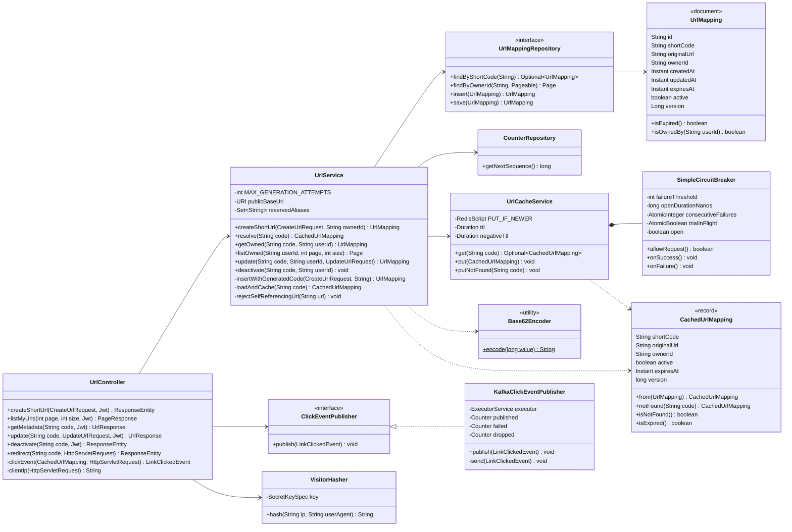

### 3.2 Data model

**MongoDB `shortlink.url_mappings`**

| Field | Type | Notes |
|---|---|---|
| `_id` | ObjectId | |
| `shortCode` | string | **unique index** `shortCode`; 1–32 chars of `[A-Za-z0-9_-]` |
| `originalUrl` | string | ≤ 2048 chars, absolute http(s) |
| `ownerId` | string | auth-service user id (JWT `sub`); null for links created before auth existed |
| `createdAt`, `updatedAt` | date | |
| `expiresAt` | date \| null | null means the link never expires |
| `active` | bool | false = deactivated (soft delete) |
| `version` | long | Spring Data `@Version`: 0 on insert, +1 on every save |

Indexes: `{shortCode: 1}` unique, `{ownerId: 1, createdAt: -1}` (`owner_created_idx`).
Created at startup because `spring.data.mongodb.auto-index-creation=true`.

**MongoDB `shortlink.counters`**: `{ _id: "url_seq", seq: <long> }`, a
single document incremented atomically with `findAndModify` (`$inc`,
`upsert`, `returnNew`).

**Redis key schema**

| Key | Type | Fields | TTL |
|---|---|---|---|
| `shortlink:url:v2:{shortCode}` | hash | `v` = version (string long), `d` = CachedUrlMapping JSON | 3600 s positive, 60 s negative |

`d` example: `{"shortCode":"aB3x","originalUrl":"https://example.com","ownerId":"6ae7…","active":true,"expiresAt":null,"version":4}`.
A negative entry has `originalUrl: null` and `version: -1`.

### 3.3 API contract

| Method & path | Request | Success | Errors |
|---|---|---|---|
| `POST /api/urls` | `{"originalUrl", "customAlias"?, "expiresAt"?}` | **201**, `Location: /api/urls/{code}`, UrlResponse | 400 validation / reserved alias / self-reference · 401 · 409 alias taken |
| `GET /api/urls?page=0&size=20` | — | **200** PageResponse of UrlResponse, newest first, size clamped to 1–100 | 401 |
| `GET /api/urls/{code}` | — | **200** UrlResponse | 401 · 404 (missing *or* not yours) |
| `PUT /api/urls/{code}` | `{"originalUrl", "expiresAt"?}` (full replacement) | **200** UrlResponse | 400 · 401 · 404 · 409 concurrent modification |
| `DELETE /api/urls/{code}` | — | **204** (idempotent) | 401 · 404 |
| `GET /{code}` | — | **302** `Location: <originalUrl>`, `Cache-Control: no-store` | 404 unknown/inactive · 410 expired |

```jsonc
// UrlResponse
{
  "shortCode": "my-link",
  "shortUrl": "http://localhost:8080/my-link",
  "originalUrl": "https://example.com/a/very/long/path",
  "createdAt": "2026-11-01T10:00:00Z",
  "updatedAt": "2026-11-01T10:00:00Z",
  "expiresAt": null,
  "active": true
}

// PageResponse<UrlResponse>
{ "content": [ /* UrlResponse … */ ], "page": 0, "size": 20, "totalElements": 42, "totalPages": 3 }
```

Validation rules: `originalUrl` is required, ≤ 2048 characters, and checked
by `@HttpUrl`: it must parse with `java.net.URI`, have an http/https scheme
and a non-blank host, and contain no whitespace or control characters.
`customAlias` must match `^[a-zA-Z0-9_-]{3,32}$`. `expiresAt` is `@Future`.
Business rules in `UrlService`: aliases are checked case-insensitively
against `app.reserved-aliases`, and the destination's host and port must not
equal the shortener's public base URL.

### 3.4 Flow: create a short link

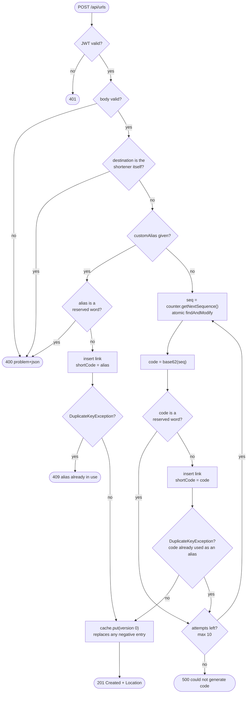

Why insert-and-catch instead of `exists()` then insert: two concurrent
requests for the same alias can both pass an `exists()` check. The unique
index makes exactly one insert win. Verified live: 10 concurrent requests
for one alias produced one 201 and nine 409s.

Why generated codes need a retry: a custom alias can equal a future counter
value (`"100"` = base62(3844)). When the counter reaches it, the insert hits
the unique index and the loop moves on to the next value.

### 3.5 Flow: redirect (resolve)

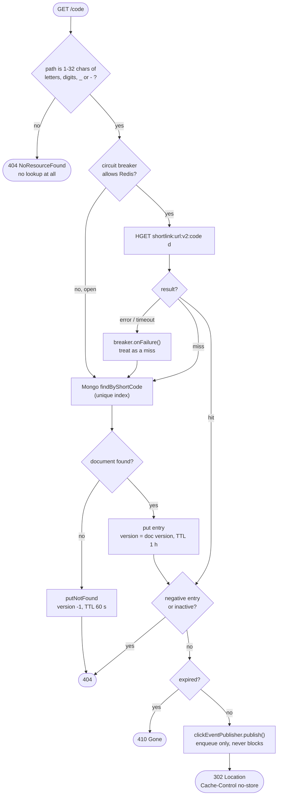

Inactive and expired links are cached too: the entry carries `active` and
`expiresAt`, so a dead link also stops costing a Mongo read per request.

### 3.6 Version-checked cache writes

Every cache write, whether a fill on a miss or a write-through after
create, update or deactivate, runs this script atomically in Redis:

```lua
-- KEYS[1] = shortlink:url:v2:{code}   ARGV[1] = version   ARGV[2] = json   ARGV[3] = ttl seconds
local current = redis.call('HGET', KEYS[1], 'v')
if current and tonumber(current) >= tonumber(ARGV[1]) then
  return 0                                   -- same or newer entry already cached: reject
end
redis.call('HSET', KEYS[1], 'v', ARGV[1], 'd', ARGV[2])
redis.call('EXPIRE', KEYS[1], ARGV[3])
return 1
```

**The race this prevents.** With a plain "evict on write", a slow reader can
put back a copy that is already stale:

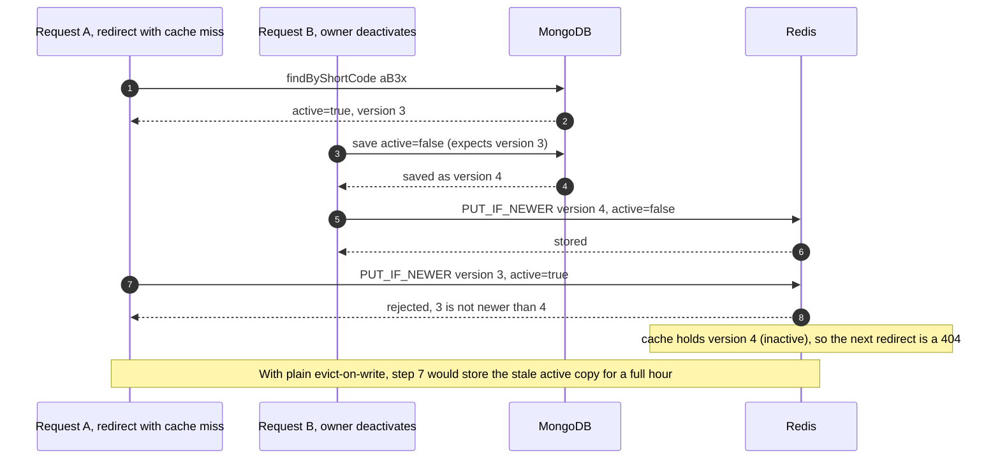

The same rule covers two edits racing each other (writes can arrive in any
order; the higher version wins). It also covers negative entries: a create
writes version 0, which replaces a version −1 "not found" entry.

### 3.7 Circuit breaker (Redis)

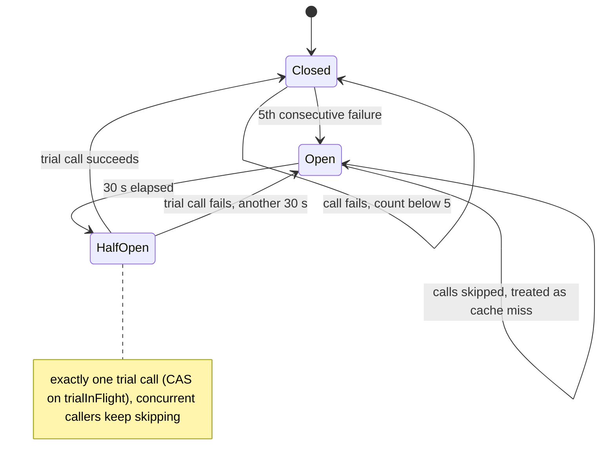

It sits on top of two other fail-fast measures:

| Layer | Setting | Effect |
|---|---|---|
| Lettuce command and connect timeout | 250 ms | a slow Redis costs at most 250 ms per call |
| Lettuce `DisconnectedBehavior.REJECT_COMMANDS` | `RedisConfig` | while disconnected, commands fail immediately instead of queueing until they time out |
| `SimpleCircuitBreaker` | 5 failures, 30 s open | during an outage Redis isn't called at all |

Measured with Redis down: redirects averaged about 10 ms through the gateway.

### 3.8 Flow: publishing click events

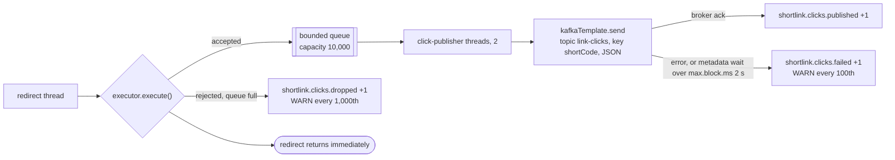

**Event construction** (in `UrlController`): `eventId = UUID`,
`occurredAt = now` truncated to milliseconds, `referrer` = `Referer`
header, `userAgent` = `User-Agent` header,
`visitorHash = hex(HMAC-SHA256(key, clientIp + "|" + userAgent))[0..32]`.
`clientIp` is the first `X-Forwarded-For` hop, which is the real peer
because the gateway rewrites that header, falling back to the socket
address.

Spring Kafka's default `LoggingProducerListener` is replaced with a no-op,
because it would log one ERROR line, with the payload, per failed click.

### 3.9 Sequence: update a link

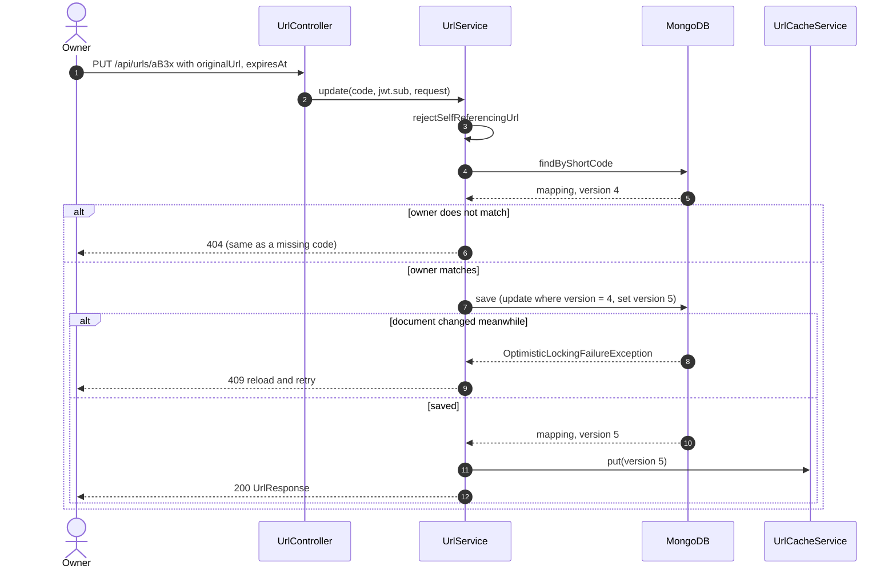

`deactivate` follows the same path: it sets `active=false` and returns
early, without saving, if the link is already inactive.

---

## 4. auth-service

### 4.1 Class diagram

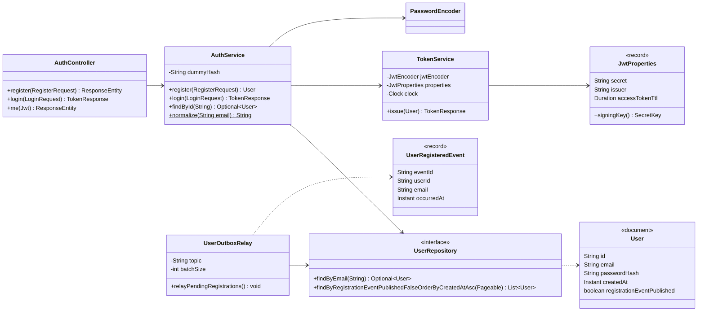

### 4.2 Data model

**MongoDB `shortlink_auth.users`**

| Field | Type | Notes |
|---|---|---|
| `_id` | ObjectId | becomes the JWT `sub` and every service's `ownerId` |
| `email` | string | trimmed and lower-cased; **unique index** |
| `passwordHash` | string | BCrypt (strength 10) |
| `createdAt` | date | |
| `registrationEventPublished` | bool | outbox flag; indexed |

### 4.3 API contract

| Method & path | Request | Success | Errors |
|---|---|---|---|
| `POST /api/auth/register` | `{"email", "password"}`: email valid and ≤ 254 chars, password 8–72 chars | **201** `{"id","email","createdAt"}` | 400 · 409 email taken |
| `POST /api/auth/login` | `{"email", "password"}` | **200** `{"accessToken","tokenType":"Bearer","expiresIn":3600}` | 400 · 401 (same message for unknown email and wrong password) |
| `GET /api/auth/me` | Bearer token | **200** `{"id","email","createdAt"}` | 401 |

### 4.4 Flow: login

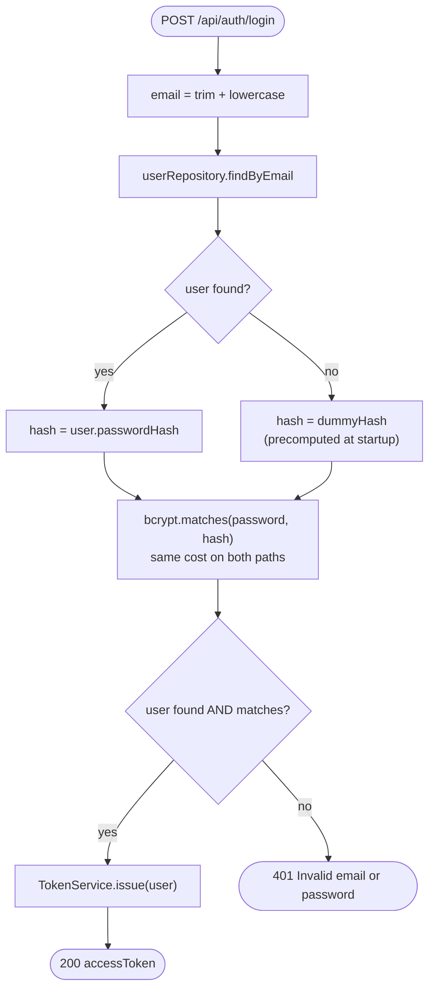

Running bcrypt against a dummy hash for unknown emails makes both failure
paths take the same time, so response timing can't be used to discover
which emails are registered.

### 4.5 Access-token structure

```jsonc
// header
{ "alg": "HS256", "typ": "JWT" }
// claims
{
  "iss": "shortlink-auth",
  "sub": "6ae76920cc2d05794d352363",
  "email": "me@example.com",
  "iat": 1793550000,
  "exp": 1793553600,
  "jti": "1b4c6f0e-6a55-4c1e-9f0a-6f1f3f1c2d9e"
}
```

Other services rely only on `sub`, with `iss` and `exp` checked by the
validator. The TTL comes from `app.jwt.access-token-ttl` (default 1 h).

### 4.6 Flow: registration outbox relay

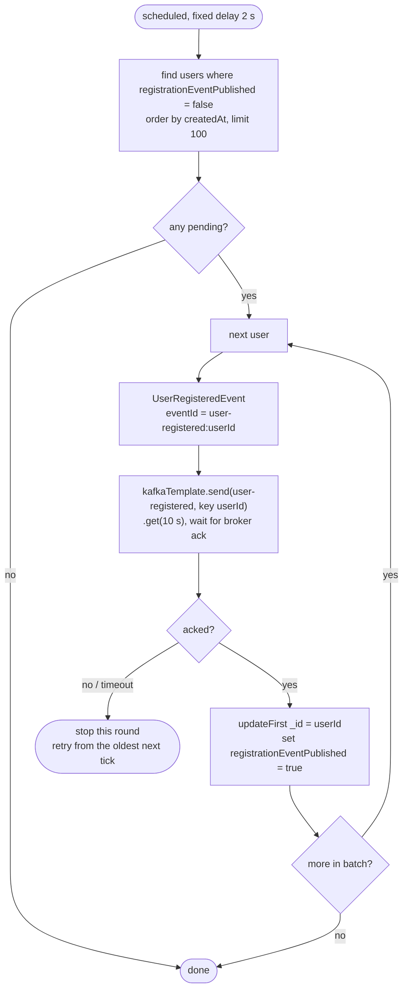

Atomicity comes from MongoDB single-document writes: registration inserts
the user and the "still to publish" flag in one document, so no replica set
or multi-document transaction is needed. Delivery is at-least-once (a crash
between the ack and the flag update republishes the event), and the
deterministic `eventId` lets notification-service deduplicate.

---

## 5. analytics-service

### 5.1 Class diagram

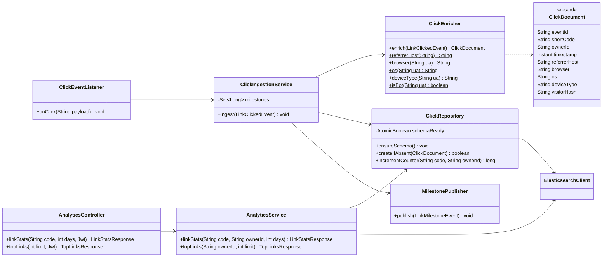

### 5.2 Elasticsearch schema

Each index is installed both as an index template (`<index>-template`) and
as an index, with 1 shard, 0 replicas in dev, and `dynamic: strict`.

```jsonc
// link-clicks          (one document per click, _id = eventId)
{ "properties": {
    "eventId":      { "type": "keyword" },
    "shortCode":    { "type": "keyword" },
    "ownerId":      { "type": "keyword" },
    "timestamp":    { "type": "date" },
    "referrerHost": { "type": "keyword" },
    "browser":      { "type": "keyword" },
    "os":           { "type": "keyword" },
    "deviceType":   { "type": "keyword" },
    "visitorHash":  { "type": "keyword" } } }

// link-click-counters  (one document per link, _id = shortCode)
{ "properties": {
    "shortCode": { "type": "keyword" },
    "ownerId":   { "type": "keyword" },
    "total":     { "type": "long" } } }
```

Why also a template: indexing into a missing index auto-creates it, and
with dynamic mapping strings become `text` fields, which breaks the `term`
filters and `terms` aggregations below. With the template, even an
auto-created index gets the right mapping.

### 5.3 Flow: click ingestion

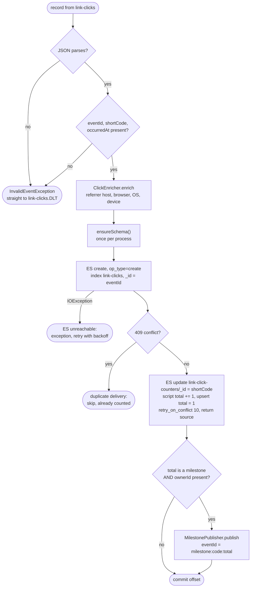

Milestones are `1, 10, 100, 1000, 10000, 100000, 1000000` (`app.milestones`).
Because the Kafka key is `shortCode`, all clicks for one link are handled
sequentially by one consumer thread, so counter updates for a link never
compete with each other. If the counter update fails after the click
document was created, the retry sees a 409 and skips the counter: the total
used for milestones can drift one low, while the stats API, which counts
click documents, stays exact.

### 5.4 Enrichment rules

Rules are evaluated in order; the first match wins. The order matters
because user agents imitate each other: Edge's contains `Chrome` and
`Safari`, and the iPhone's contains `Mac OS X`.

| Dimension | Rules, in order | Fallback |
|---|---|---|
| Bot | contains (case-insensitive) `bot`, `crawler`, `spider`, `slurp`, `facebookexternalhit`, `embedly`, `preview`, `curl/`, `wget/`, `python-requests`, `httpclient`, `okhttp`, `java/`, `go-http-client`, `headless` → browser `Bot`, device `bot` | — |
| Browser | `Edg/`·`EdgA/`·`EdgiOS/` → Edge · `OPR/`·`Opera` → Opera · `SamsungBrowser/` → Samsung Internet · `Firefox/`·`FxiOS/` → Firefox · `Chrome/`·`CriOS/`·`Chromium/` → Chrome · `Safari/` + `Version/` → Safari | `Other` (`unknown` if UA blank) |
| OS | `Windows NT`/`Windows Phone` → Windows · `iPhone`/`iPad`/`iPod` → iOS · `Android` → Android · `CrOS` → ChromeOS · `Mac OS X`/`Macintosh` → macOS · `Linux` → Linux | `Other` |
| Device | `iPad`, `Tablet`, or `Android` without `Mobile` → tablet · `Mobi`, `iPhone`, `iPod`, `Android` → mobile | `desktop` |
| Referrer | host of the `Referer` URL, lower-cased, `www.` stripped | `direct` |

### 5.5 Stats query

`GET /api/analytics/links/{code}?days=N` (N clamped to 1–365) runs a single
search that returns no hits, only aggregations:

```json
{
  "size": 0,
  "track_total_hits": true,
  "query": { "bool": { "filter": [
      { "term": { "shortCode": "my-link" } },
      { "term": { "ownerId":   "<jwt.sub>" } } ] } },
  "aggs": {
    "unique_visitors":   { "cardinality": { "field": "visitorHash" } },
    "referrers":         { "terms": { "field": "referrerHost", "size": 10 } },
    "browsers":          { "terms": { "field": "browser",      "size": 10 } },
    "operating_systems": { "terms": { "field": "os",           "size": 10 } },
    "devices":           { "terms": { "field": "deviceType",   "size": 10 } },
    "recent": {
      "filter": { "range": { "timestamp": { "gte": "now-29d/d" } } },
      "aggs": { "per_day": { "date_histogram": {
          "field": "timestamp", "calendar_interval": "day", "format": "yyyy-MM-dd",
          "min_doc_count": 0,
          "extended_bounds": { "min": "now-29d/d", "max": "now/d" } } } } }
  }
}
```

```jsonc
// LinkStatsResponse
{
  "shortCode": "my-link",
  "totalClicks": 4,
  "uniqueVisitors": 3,
  "days": 30,
  "clicksPerDay":     [ { "date": "2026-10-03", "clicks": 0 }, "…", { "date": "2026-11-01", "clicks": 4 } ],
  "topReferrers":     [ { "value": "direct", "count": 2 }, { "value": "twitter.com", "count": 1 } ],
  "browsers":         [ { "value": "Chrome", "count": 2 }, { "value": "Safari", "count": 1 } ],
  "operatingSystems": [ { "value": "Windows", "count": 2 }, { "value": "iOS", "count": 1 } ],
  "devices":          [ { "value": "desktop", "count": 3 }, { "value": "mobile", "count": 1 } ]
}
```

`GET /api/analytics/links?limit=N` (1–100) filters on `ownerId` with a
`terms` aggregation on `shortCode`, and returns
`{"totalClicks", "links":[{"shortCode","clicks"}]}`. Because of the
`ownerId` filter, another user's code returns zeros. Elasticsearch errors
map to **503**.

---

## 6. notification-service

### 6.1 Class diagram

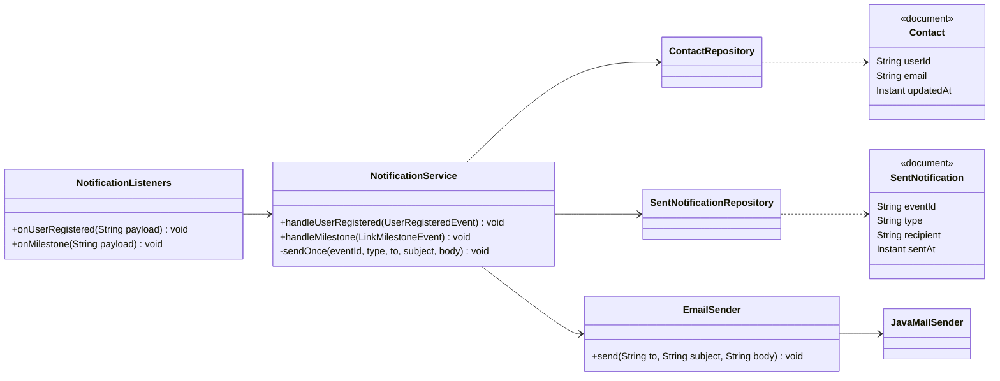

### 6.2 Data model

| Collection (`shortlink_notifications`) | `_id` | Fields | Written by |
|---|---|---|---|
| `contacts` | userId | `email`, `updatedAt` | upsert on every `UserRegistered` |
| `sent_notifications` | eventId | `type` (WELCOME, MILESTONE), `recipient`, `sentAt` | after a successful SMTP send |

### 6.3 Flow: handling an event

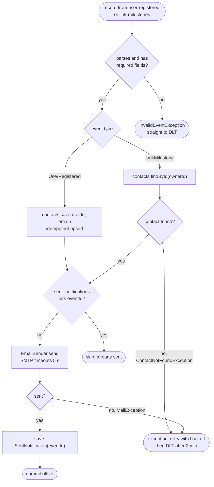

Email templates (plain text):

| Event | Subject |
|---|---|
| UserRegistered | `Welcome to ShortLink` |
| LinkMilestone, n = 1 | `Your link {publicBaseUrl}/{code} got its first click` |
| LinkMilestone, n > 1 | `Your link {publicBaseUrl}/{code} reached {n, formatted as 1,000} clicks` |

Ordering is check → send → record. A crash between send and record causes
one duplicate email on redelivery, which is the chosen trade-off;
recording first could lose the email entirely.

---

## 7. api-gateway

### 7.1 Request pipeline

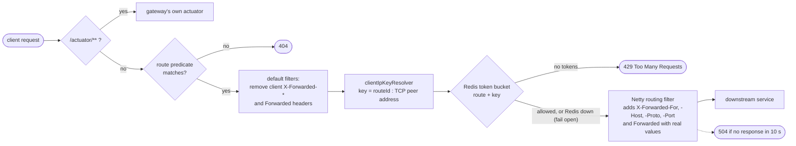

### 7.2 Routes

Routes are matched in declaration order.

| id | Predicates | Upstream (env) | replenishRate / burstCapacity |
|---|---|---|---|
| `auth` | `Path=/api/auth/**` | `AUTH_SERVICE_URI` | 2 / 10 |
| `urls` | `Path=/api/urls,/api/urls/**` | `URL_SERVICE_URI` | 10 / 30 |
| `analytics` | `Path=/api/analytics/**` | `ANALYTICS_SERVICE_URI` | 5 / 20 |
| `redirect` | `Method=GET`, `Path=/{code:[A-Za-z0-9_-]+}` | `URL_SERVICE_URI` | 50 / 100 |

Other settings: CORS on `/api/**` for `CORS_ALLOWED_ORIGINS`; HTTP client
timeouts of 2 s (connect) and 10 s (response). Readiness includes only
`readinessState`, not Redis. Lettuce uses `REJECT_COMMANDS` while
disconnected (as in url-service), so a Redis outage costs nothing per request.

**Rate-limit key = `{routeId}:{peer IP}`.** `RedisRateLimiter` stores the
bucket as `request_rate_limiter.{key}.tokens` and `...timestamp`, using the
resolved key only, while it takes rate and burst from the route being
called. With an IP-only key all routes share one bucket and the auth route's
burst of 10 throttles everything else. That was observed in docker-compose
(12 logins, then 10 redirects returned 429) and is fixed by the route prefix.

**Why forwarding headers are stripped and rewritten.** url-service builds
its `Location` header from `Forwarded` / `X-Forwarded-Host`
(`server.forward-headers-strategy=framework`) and hashes the first
`X-Forwarded-For` hop as the visitor IP. If client-supplied values passed
through, a client could fake its visitor identity or the host in its URLs.
The gateway removes them and sets its own (covered by `GatewayRoutingTest`).

---

## 8. Kafka specification

### 8.1 Topics

| Topic | Partitions / RF (dev) | Key | Declared by | Retention |
|---|---|---|---|---|
| `link-clicks` | 3 / 1 | shortCode | url-service, analytics-service | broker default (7 days) |
| `user-registered` | 3 / 1 | userId | auth-service, notification-service | broker default |
| `link-milestones` | 3 / 1 | shortCode | analytics-service, notification-service | broker default |
| `link-clicks.DLT` | 3 / 1 | as source | analytics-service | broker default |
| `user-registered.DLT`, `link-milestones.DLT` | 3 / 1 | as source | notification-service | broker default |

Consumers declare the topics they read as well as producers. Creation is
idempotent, and it means a consumer never subscribes to a missing topic and
sits idle until its next metadata refresh (up to 5 minutes).

### 8.2 Event schemas

```jsonc
// link-clicks
{ "eventId": "8604cd87-d700-456d-9b1e-0c4b1d7f3a21", "shortCode": "my-link", "ownerId": "6ae7…",
  "occurredAt": "2026-11-01T10:00:00.123Z", "referrer": "https://twitter.com/x/status/1",
  "userAgent": "Mozilla/5.0 (iPhone; …)", "visitorHash": "3f9a0c…(32 hex)" }

// user-registered
{ "eventId": "user-registered:6ae7…", "userId": "6ae7…", "email": "me@example.com",
  "occurredAt": "2026-11-01T09:59:00Z" }

// link-milestones
{ "eventId": "milestone:my-link:100", "shortCode": "my-link", "ownerId": "6ae7…",
  "milestone": 100, "occurredAt": "2026-11-01T10:05:00Z" }
```

### 8.3 Client configuration

| Service | Role | Key settings |
|---|---|---|
| url-service | producer | `acks=all` (idempotent producer), `max.block.ms=2000`, `linger.ms=5`, `delivery.timeout.ms=30000`, `request.timeout.ms=10000` |
| auth-service | producer | `acks=all`, `max.block.ms=3000`, `delivery.timeout.ms=10000`; synchronous `get(10 s)` in the relay |
| analytics-service | consumer + producer | group `analytics-service`, `auto-offset-reset=earliest`, `max.poll.records=100`, concurrency 3 |
| notification-service | consumer | group `notification-service`, `auto-offset-reset=earliest` (rebuilds contacts from history) |
| all | admin | `operation-timeout=5s`, `fail-fast=false` (start even if Kafka is down) |

### 8.4 Consumer error handling

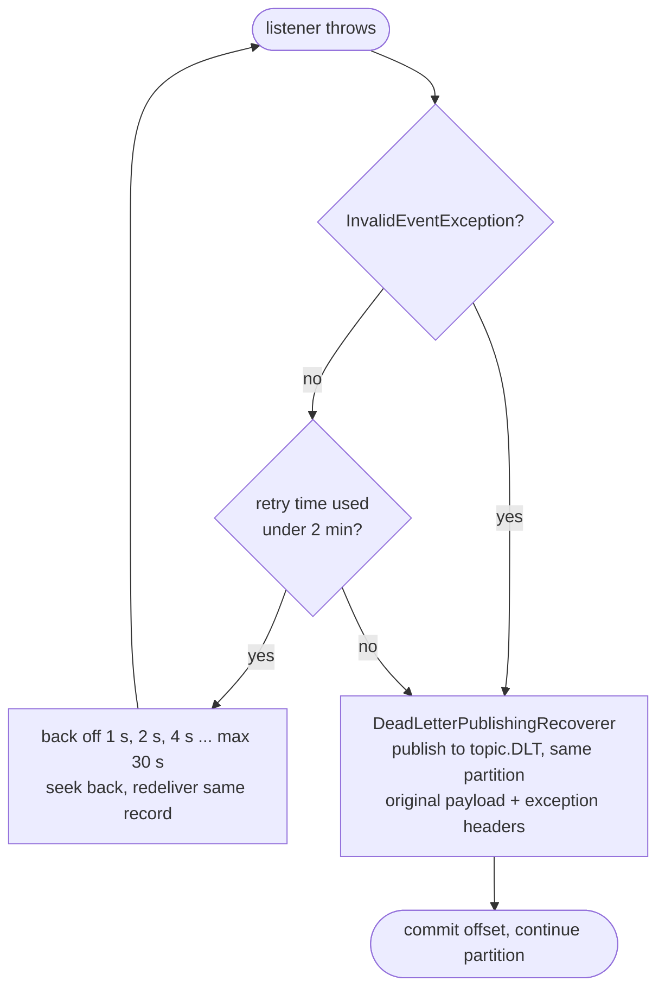

`DefaultErrorHandler(new DeadLetterPublishingRecoverer(template),
ExponentialBackOff(1000 ms, ×2, maxInterval 30 s, maxElapsed 2 min))`.
Retrying in place keeps per-partition order during short outages; the time
cap stays well under `max.poll.interval.ms` (5 minutes) and stops one stuck
record from blocking its partition forever.

---

## 9. Configuration reference

| Variable | Used by | Default (local) | Purpose |
|---|---|---|---|
| `JWT_SECRET` | url, auth, analytics | **none, required** (≥ 32 bytes) | HS256 key |
| `JWT_ISSUER` | url, auth, analytics | `shortlink-auth` | expected `iss` |
| `JWT_TTL` | auth | `1h` | access-token lifetime |
| `MONGODB_URI` | url, auth, notification | `mongodb://localhost:27017/<service db>` | |
| `REDIS_HOST` / `REDIS_PORT` | url, gateway | `localhost` / `6379` | |
| `REDIS_TIMEOUT`, `REDIS_CONNECT_TIMEOUT` | url | `250ms` | fail-fast cache |
| `CACHE_TTL_SECONDS` / `CACHE_NEGATIVE_TTL_SECONDS` | url | `3600` / `60` | |
| `KAFKA_BOOTSTRAP_SERVERS` | url, auth, analytics, notification | `localhost:9092` | |
| `ANALYTICS_ENABLED` | url | `true` | `false` = no Kafka, no-op publisher |
| `VISITOR_HASH_KEY` | url | random per process | HMAC key for visitor ids |
| `PUBLIC_BASE_URL` | url, notification | `http://localhost:8080` | short URLs, self-reference check, email links |
| `ELASTICSEARCH_URIS` | analytics | `http://localhost:9200` | |
| `MAIL_HOST` / `MAIL_PORT` / `MAIL_FROM` | notification | `localhost` / `1025` / `ShortLink <no-reply@shortlink.local>` | SMTP |
| `URL_SERVICE_URI`, `AUTH_SERVICE_URI`, `ANALYTICS_SERVICE_URI` | gateway | `http://localhost:8081/8083/8082` | upstreams |
| `CORS_ALLOWED_ORIGINS` | gateway | `http://localhost:3000` | |

Probes on every service: `/actuator/health/liveness` and
`/actuator/health/readiness`. Readiness includes url `mongo`, auth `mongo`,
analytics `elasticsearch`, notification `mongo`, and for the gateway
nothing beyond its own state.

---

## 10. Testing strategy

| Level | What | Where |
|---|---|---|
| Unit (Mockito, no Spring) | Code generation and retries, resolve paths, ownership, versioned cache writes, circuit breaker state machine, URL validator, Base62, click publisher back-pressure, auth/login timing, outbox relay, enrichment rules, ingestion idempotency, notification idempotency | `*Test` in each module |
| Slice (`@WebMvcTest` + real `SecurityConfig`) | HTTP contracts, 401s, problem+json, validation messages, page clamping, 503 mapping | `*ControllerTest` |
| Wiring (`ApplicationContextRunner`) | Beans with several constructors are built correctly by Spring (a bug found by running the app) | `*WiringTest` |
| Crypto round-trip | Real encoder and decoder: valid, expired, wrong issuer, wrong key, short secret | `JwtRoundTripTest` |
| Component (gateway booted, stub upstream, no Redis) | Routing, junk-path rejection, forwarding-header rewriting, rate-limiter fail-open, readiness | `GatewayRoutingTest` |
| End-to-end (running stack) | 35 checks across auth, links, redirects, ownership, edits, analytics, deactivation; optional email checks via Mailpit | `scripts/smoke-test.sh` |

`mvn clean install` in `backend/` runs 153 tests with no Docker required.
